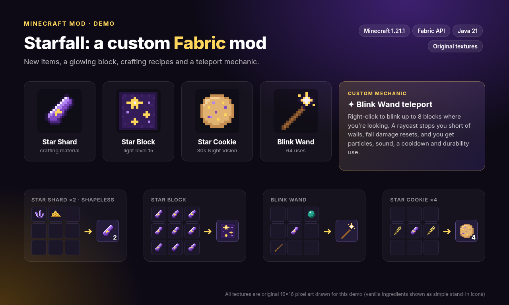

# Starfall: Fabric mod demo

A small **Minecraft Fabric mod** for **Minecraft 1.21.1**, made as a portfolio demo project by Ian Esquivel ([@esquivel-stuff](https://github.com/esquivel-stuff)).
It shows the basics of a custom mod: registering items and blocks, data-driven recipes and loot, translations, a creative tab, original textures, and one custom gameplay mechanic.



## Content

| Thing | Details |
| --- | --- |
| **Star Shard** (item) | Crafting material. Shapeless: Amethyst Shard + Glowstone Dust → 2 Star Shards. |
| **Star Block** (block) | Decorative block with light level 15 and amethyst sounds. 9 Star Shards → 1 block, and back again. Mine it with a pickaxe. |
| **Star Cookie** (food) | Wheat + Star Shard + Wheat → 4 cookies. Restores 4 hunger, can always be eaten, and gives 30 s of Night Vision. |
| **Blink Wand** (tool) | Ender Pearl, Star Shard and Stick on a diagonal. **Right-click to teleport up to 8 blocks** in the direction you're looking. |

### The mechanic: Blink Wand

`BlinkWandItem` raycasts from the player's eyes along their look direction (8 blocks).
If it hits a block, the player lands half a block short of it so they never end up inside a wall.
The wand then resets fall distance, spawns portal and end-rod particles, plays a sound, uses 1 durability (64 total) and applies a 1.5 s cooldown.

Everything appears in its own **Starfall** creative tab, with English and Brazilian Portuguese translations.

## Versions

- Minecraft 1.21.1 · Fabric Loader 0.19.5 · Fabric API 0.116.17+1.21.1
- Fabric Loom 1.18 (Mojang official mappings) · Gradle 9.7.1 (wrapper)
- Mod is compiled for Java 21. **Running Gradle needs JDK 25+** because current Loom requires it.

## Build

```bash
./gradlew build
# -> build/libs/starfall-1.0.0.jar
```

Drop the jar plus [Fabric API](https://modrinth.com/mod/fabric-api) into the `mods/` folder of a Fabric 1.21.1 install.
For development, `./gradlew runClient` or `./gradlew runServer` starts the game with the mod loaded.

## Textures

All textures are original 16×16 pixel art generated by `scripts/gen_textures.py` from character grids.
JSON models, recipes, loot tables and translations come from `scripts/gen_resources.py`.
Re-run them after editing:

```bash
python3 scripts/gen_textures.py   # needs Pillow
python3 scripts/gen_resources.py
```

## License

MIT
