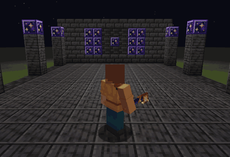

# Starfall: a small Fabric mod

A small **Minecraft 1.21.1 Fabric mod** by Ian Esquivel ([@esquivel-stuff](https://github.com/esquivel-stuff)).
Three items and a block, data-driven recipes and one mechanic: a wand that blinks you forward. The scope is small on purpose. The work went into the details: where the wand puts you, how the blink looks and sounds, and what every item says when you hover it.




*Real capture from the Minecraft 1.21.1 Fabric dev client (software rendered under Xvfb, so it runs at a low frame rate).*

## Content

| Thing | Recipe | What it does |
| --- | --- | --- |
| **Star Shard** | Amethyst Shard + Glowstone Dust → 2 (shapeless) | Crafting material. Animated twinkle. |
| **Star Block** | 9 Star Shards → 1 (and back to 9) | Light level 15, emissive so it stays bright at night, slow twinkle animation, sheds a few motes of starlight. Amethyst sounds, needs a pickaxe. |
| **Star Cookie** | Wheat + Star Shard + Wheat → 4 | Restores 4 hunger, always edible, 30 s of Night Vision. |
| **Blink Wand** | Ender Pearl, Star Shard, Stick on a diagonal | Right-click to blink up to 8 blocks where you look. 64 uses, 1.5 s recharge. |

Every item has a tooltip with a short flavour line, in English and Brazilian Portuguese.

## The Blink Wand

**Safe landing.** `BlinkWandItem.findLanding` clips the look ray against blocks, backs off 0.3 from whatever it hit, then walks back in 0.25 steps. At each step it tries lifting the player 0 to 2 blocks and accepts the first spot where the player's hitbox fits (`noCollision`) inside the world border. So you stop short of walls, step up onto ledges and never end up inside a block. If there is no spot at least 1.5 blocks away, the wand **fizzles**: no teleport, no durability cost and a shorter 0.5 s cooldown.

**Visuals.** The server sends one small packet per blink (`BlinkFxPayload`) to players within 64 blocks. The client then plays it as five beats with five custom particle types:

1. **Depart:** a small flash and sparks pulled inward into the body.
2. **Path:** a line of sparks, about 2 per block (16 at most), that burn out toward the destination.
3. **Arrive:** brighter than the departure. A 2 to 3 tick flash, a ground ring that eases out, 20 fast and 12 slow sparks, and 10 embers that fall and bounce.
4. **Linger:** a few motes that rise and fade.
5. **Fizzle:** a short sputter of embers when there is no room.

The sparks cool from white to gold to violet as they age, lifetimes are randomized so a burst does not vanish all at once, and every count scales with the player's Particles setting (All / Decreased / Minimal).

**Sound.** Three sound events (`depart`, `arrive`, `fizzle`), two variants each, with subtitles and a small random pitch. The audio is original, synthesized by `scripts/gen_sounds.py`.

**Recharge state.** While the wand is on cooldown its star dims to violet. This is an item model override on a `starfall:cooldown` predicate, with no custom renderer.

## Screenshots and renders

Real in-game captures from the dev client are in [`docs/screenshots/`](docs/screenshots): the blink sequence, the tooltips, the cooldown icon and Star Blocks at night.
Texture renders (flat images of the 16×16 textures, **not** in-game) are in [`docs/renders/`](docs/renders).
How the textures, palettes and effects were designed is in [`docs/DESIGN.md`](docs/DESIGN.md).

## Versions

- Minecraft 1.21.1 · Fabric Loader 0.19.5 · Fabric API 0.116.17+1.21.1
- Fabric Loom 1.18 (Mojang mappings) · Gradle 9.7.1 (wrapper)
- The mod targets Java 21. **Running Gradle needs JDK 25+** because current Loom requires it.
- Client-only code (particles, the FX receiver, the model predicate) lives in `src/client` (Loom split source sets), so a dedicated server never loads it.

## Build and run

```bash
./gradlew build
# -> build/libs/starfall-1.0.0.jar
```

Put the jar and [Fabric API](https://modrinth.com/mod/fabric-api) in the `mods/` folder of a Fabric 1.21.1 install.
For development, `./gradlew runClient` or `./gradlew runServer` starts the game with the mod loaded.

## Assets are generated

All textures, the mod icon, the sounds and the JSON are generated by scripts, so they can be tweaked and rebuilt:

```bash
python3 scripts/gen_textures.py    # Pillow. Item, block and particle textures, icon
python3 scripts/gen_sounds.py      # numpy + ffmpeg (libvorbis). The 6 .ogg files
python3 scripts/gen_resources.py   # models, particles, sounds.json, lang, recipes, loot
```

`scripts/starfall_art.py` holds the shared palette ramps, `scripts/icons.py` the item pixel grids and `scripts/blocks.py` the Star Block.

## What was tested

- `./gradlew clean build` passes.
- `./gradlew runServer`: the mod loads and the dedicated server starts.
- `./gradlew runClient` in a real singleplayer world: blinking forward stops short of a wall, aiming at the floor lands you on top of it, the wand climbs a 1 block wall, blinking point-blank into a wall fizzles without moving you, the cooldown icon swaps, the tooltips show and the Star Block glows.

Not tested yet: hearing the sounds in-game (the test machine has no audio device), the Decreased and Minimal particle settings, what other players see in multiplayer, and the Portuguese text in-game.

## License

MIT
